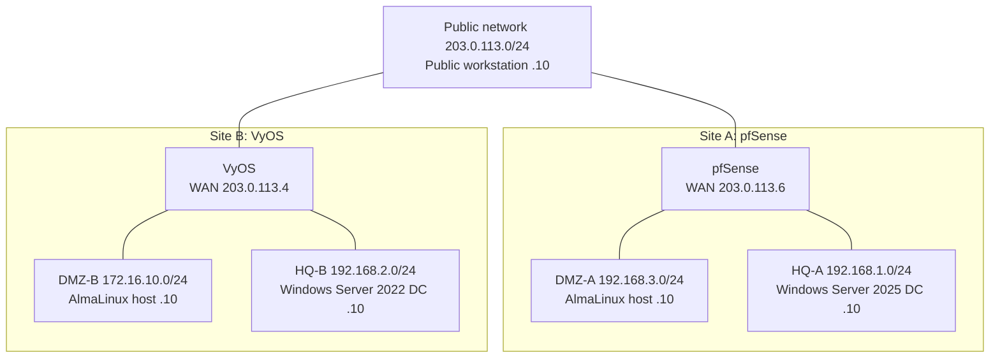

# Project 1: Firewall Configuration and Management

**Focus:** perimeter security, segmentation, NAT, DMZ publishing, Active Directory foundations
**Platforms:** pfSense CE, VyOS (rolling 1.5-series), AlmaLinux 10, Windows Server 2022/2025, Windows 11, Nutanix AHV

## Scenario

A fictional enterprise is building the base of a larger network with two independently managed sites. Each site is protected by a different firewall platform so the two can be compared. Each site has a private network with its own domain controller and a DMZ for public-facing services. The sites are not joined, but traffic between them must be possible and controlled.

## Solution scope

1. Build a public network plus four isolated segments: two private (HQ) and two DMZ.
2. Deploy pfSense (Site A) and VyOS (Site B) as the gateway for each side.
3. Promote one Windows Server on each side to a domain controller (separate domains, no trust).
4. Publish DMZ services: HTTP and FTP on Site A, HTTP, FTP, and TFTP on Site B.
5. Give each domain controller transparent outbound access and block everything not explicitly required.
6. Monitor traffic through the firewalls.

## Architecture

## Virtual machines

| Role | OS / image | RAM | Disk | Networks |
|------|------------|-----|------|----------|
| Public workstation | Windows 11 24H2 | 4 GB | 64 GB | Public |
| Site A DC | Windows Server 2025 | 2 GB | 48 GB | HQ-A |
| Site B DC | Windows Server 2022 | 2 GB | 48 GB | HQ-B |
| Site A firewall | pfSense CE | 1 GB | 16 GB | Public, HQ-A, DMZ-A |
| Site A DMZ host | AlmaLinux 10.0 | 1 GB | 24 GB | DMZ-A |
| Site B firewall | VyOS rolling 2025.08 | 1 GB | 12 GB | Public, DMZ-B, HQ-B |
| Site B DMZ host | AlmaLinux 10.0 | 1 GB | 24 GB | DMZ-B |

## Procedure summary

1. **Virtual networks:** one public network and four isolated segments on the hypervisor.
2. **Windows 11 workstation:** UEFI with Secure Boot and a virtual TPM (required by Windows 11).
3. **Windows Servers:** install the OS and the hypervisor guest tools, set static IPs, install AD DS and DNS, and promote each server to the first DC of a **new forest**. The two sites use separate domains.
4. **pfSense:** UEFI VM with **Secure Boot disabled**, ZFS stripe on a 16 GB disk. After install, eject the ISO, answer "no" to VLANs, and assign the WAN, HQ, and DMZ interfaces at the console. Finish in the web GUI.
5. **VyOS:** boot the live image, run `install image`, power off, detach the ISO, and boot from disk. Configure from the CLI with `configure`, `commit`, and `save`.
6. **DMZ hosts:** install AlmaLinux and the services to publish (web, FTP, and TFTP on Site B).
7. **Policy:** apply the NAT and firewall policy below, then test from the public workstation and from each DC.

## Firewall policy design

| Traffic | Policy |
|---------|--------|
| Public → DMZ (HTTP, FTP; plus TFTP at Site B) | Allow via port forward / destination NAT |
| Site B DC → Site A DMZ (HTTP, FTP) | Allow |
| HQ (DC) → Internet and DMZ | Allow, with source NAT toward the public side |
| DMZ → HQ | Deny |
| Public → HQ | Deny |
| Anything else | Deny (default) |

FTP is awkward behind NAT because it opens a second data connection. Configure a fixed passive port range on the server and allow it, and on VyOS enable the FTP and TFTP connection-tracking helpers.

## Reference configuration

See [`configs/vyos-site-b-reference.cfg`](configs/vyos-site-b-reference.cfg). A normalized Site B firewall design covering NAT, stateful filtering, DMZ publishing, and conntrack helpers. It has not been re-tested.

## Results

- All seven VMs deployed with static addressing; both servers promoted to domain controllers in separate forests.
- **pfSense (Site A):** firewall policy blocked and allowed exactly the required traffic. DMZ HTTP and FTP were reachable from the public workstation and from the Site B DC, the Site A DC had transparent outbound and DMZ access, and traffic could be monitored.
- **VyOS (Site B):** default-deny filtering, source NAT for the private network, a correct default route, and traffic monitoring in place.

## Troubleshooting summary

| Issue | Root cause | Details |
|-------|-----------|---------|
| pfSense VM would not boot | Secure Boot enabled for a FreeBSD guest | [troubleshooting](troubleshooting.md) |
| Hosts behind VyOS could not reach external addresses | Default gateway mistyped (wrong host in the public subnet) | [troubleshooting](troubleshooting.md) |
| Hosts behind VyOS could ping the firewall but not the internet | Missing source NAT; private addresses leaving the WAN | [troubleshooting](troubleshooting.md) |

## Lessons learned

1. **Hypervisor boot settings are guest-specific.** Windows 11 needs UEFI, Secure Boot, and a vTPM. pfSense (FreeBSD) failed to boot with Secure Boot on.
2. **Commit incrementally on VyOS.** Commit after each logical block so a failed commit points at the faulty change. `compare` and `commit-confirm` are useful safety nets.
3. **Describe every rule.** Descriptions make rule sets auditable and reduce accidental edits.
4. **Know the packet path.** NAT decisions and filter chains (VyOS `input` for traffic to the router, `forward` for traffic through it) are separate, and a rule in the wrong chain never matches.
