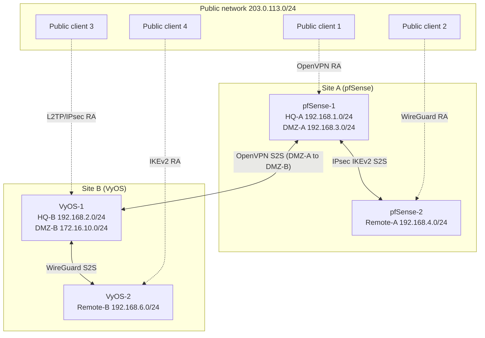

# Project 2: Site-to-Site and Remote-Access VPNs

**Focus:** VPN design and deployment across four protocols, with directory-backed authentication
**Platforms:** pfSense CE, VyOS, WireGuard, OpenVPN, IPsec (IKEv2), L2TP/IPsec, Windows NPS (RADIUS), Windows 11 clients

## Scenario

The fictional enterprise adds **two remote sites**, one behind each firewall platform from [Project 1](../01-firewall-configuration/), and wants staff to work from home with access to business resources as if on site. The solution is three site-to-site VPNs plus four remote-access VPNs.

## Architecture

## VPN inventory

| # | Type | Technology | Endpoints | Reaches | User authentication |
|---|------|-----------|-----------|---------|---------------------|
| 1 | Site-to-site | IPsec IKEv2 (pfSense) | pfSense-1 ↔ pfSense-2 | HQ-A ↔ Remote-A | Pre-shared key (device) |
| 2 | Site-to-site | WireGuard (VyOS) | VyOS-1 ↔ VyOS-2 | HQ-B ↔ Remote-B | Public keys (device) |
| 3 | Site-to-site | OpenVPN, shared key | pfSense-1 ↔ VyOS-1 | DMZ-A ↔ DMZ-B | Shared key (device) |
| 4 | Remote access | OpenVPN (pfSense) | Public client → pfSense-1 | HQ-A | RADIUS via DC-A |
| 5 | Remote access | WireGuard (pfSense) | Public client → pfSense-2 | Remote-A | Public key (no RADIUS) |
| 6 | Remote access | IKEv2 (VyOS) | Public client → VyOS-2 | Remote-B | RADIUS via DC-B, over VPN 2 |
| 7 | Remote access | L2TP/IPsec (VyOS) | Public client → VyOS-1 | HQ-B | RADIUS via DC-B |

> **Design note.** WireGuard has no username/password mechanism, so VPN 5 uses key-based identity and the other remote-access VPNs use RADIUS.

## Protocol comparison

| Protocol | Strengths | Trade-offs |
|----------|-----------|-----------|
| IPsec / IKEv2 | Industry standard, built into Windows, supports certificates and EAP | Many parameters that must match exactly on both ends |
| WireGuard | Small, fast, modern cryptography, simple config | Key-based identity only. Needs extra tooling for user management and dynamic addressing |
| OpenVPN | Flexible, TLS-based, user/password backends such as RADIUS, UDP or TCP | Needs client software. Shared-key mode is deprecated in favor of TLS |
| L2TP/IPsec | Native OS clients | Legacy design with double encapsulation. A pre-shared key shared by all users is weak |

## Build order

1. **Infrastructure:** deploy pfSense-2 and VyOS-2, the remote-site hosts, and four public clients; assign static addresses.
2. **Site-to-site VPNs:** IPsec (pfSense), WireGuard (VyOS), OpenVPN (DMZ to DMZ).
3. **RADIUS:** install the Network Policy Server role on both DCs and register the VPN gateways as RADIUS clients ([`configs/nps-radius.md`](configs/nps-radius.md)).
4. **Client-access VPNs:** WireGuard, OpenVPN, IKEv2, and L2TP/IPsec.
5. **Validation:** test each tunnel from its client, and confirm blocked paths stay blocked.

Step 3 precedes step 4 on purpose. VPN 6 authenticates against DC-B across VPN 2, so VPN 2 must be up first.

## Implementation highlights

| VPN | Key settings | Reference |
|-----|--------------|-----------|
| IPsec S2S | IKEv2, AES-256, SHA-256, DH group 14; Phase 2 tunnel mode, ESP AES-256-GCM, PFS 14, 3600 s lifetime | [pfSense settings](configs/pfsense-vpn-settings.md) |
| WireGuard S2S | Tunnel `10.10.10.0/24`, UDP/51820, keepalive 25 s, static route to remote LAN | [wireguard-s2s](configs/vyos-wireguard-s2s.cfg) |
| OpenVPN S2S | Shared key, AES-256-CBC, SHA-512, tunnel `10.200.1.0/30` | [openvpn-s2s](configs/vyos-openvpn-s2s.cfg) and [pfSense settings](configs/pfsense-vpn-settings.md) |
| OpenVPN RA | Remote access (user auth), tunnel `192.168.250.0/26`, RADIUS backend, client export package | [pfSense settings](configs/pfsense-vpn-settings.md) |
| WireGuard RA | Tunnel `10.6.210.0/24`, one peer per client, split-tunnel allowed IPs | [pfSense settings](configs/pfsense-vpn-settings.md) |
| IKEv2 RA | Certificate-authenticated server, EAP via RADIUS, client pool `192.168.200.0/24` | [ikev2-ra](configs/vyos-ikev2-remote-access.cfg) |
| L2TP/IPsec | PSK for IPsec, RADIUS for PPP login, pool `192.168.255.2-200` | [l2tp](configs/vyos-l2tp-ipsec.cfg) |

## Results

All seven VPNs were established and tested: public clients reached the intended private hosts through each remote-access VPN, and the three site-to-site tunnels carried traffic between their networks. RADIUS authentication worked for the VPNs that support it.

## Troubleshooting

See [troubleshooting.md](troubleshooting.md) for WireGuard handshake failures, an OpenVPN tunnel that connected but passed no traffic, and an IPsec tunnel that would not establish.

## Lessons learned

1. **Match both ends exactly.** IKE and ESP proposals, identifiers, and traffic selectors must agree. Keep a written checklist for both peers.
2. **Scope source NAT to the WAN interface.** A NAT rule with no outbound-interface restriction also rewrites traffic leaving through a tunnel, so the far end sees an unexpected source address and drops it.
3. **Label everything.** Use descriptive names and rule comments for each VPN interface and policy.
4. **Test the authentication path itself.** For RADIUS-backed VPNs, check shared secrets, the source address the RADIUS server sees, and reachability, and add periodic connection tests.
