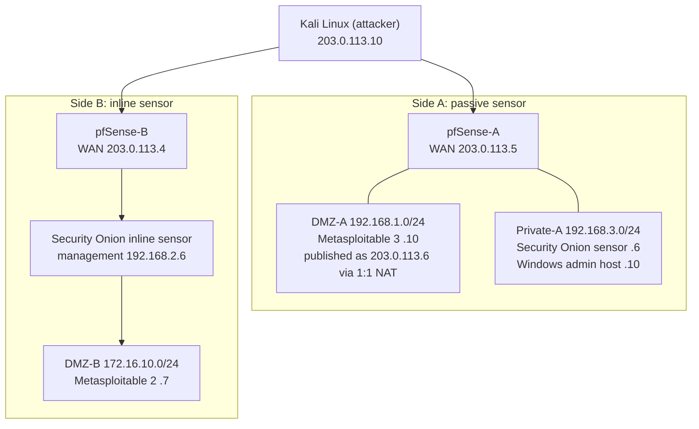

# Project 3: Network Intrusion Detection and Prevention Platform

**Focus:** attack baselining, sensor deployment, PCAP analysis, inline sensor topology
**Platforms:** Suricata via Security Onion 2.4, pfSense, Kali Linux, Metasploit, Metasploitable 2 and 3, Nutanix AHV

## Situation

The fictional enterprise had relied only on firewalls. It needed a way to see attacks against its network and a path toward blocking them.

## Solution

1. Establish an **attack baseline** against intentionally vulnerable hosts, so any control can be measured against a known-exploitable starting point.
2. Deploy a **Suricata-based sensor platform** (Security Onion) and a **PCAP capture-and-import workflow** for offline analysis.
3. Build two sensor placements: a **passive sensor** beside a firewalled DMZ, and an **inline sensor** between the firewall and a protected host.

## Architecture

## Attack scenarios

Run only against the intentionally vulnerable lab VMs.

| Scenario | Target | Weakness | Metasploit module | What a detector should look for |
|----------|--------|----------|-------------------|----------------------------------|
| Elasticsearch RCE | Metasploitable 3 (ships an Elasticsearch 1.x service) | CVE-2014-3120: dynamic scripting enabled | `exploit/multi/elasticsearch/script_mvel_rce` | HTTP request to port 9200 carrying a script payload |
| vsftpd backdoor | Metasploitable 2 | CVE-2011-2523: backdoored vsftpd 2.3.4 | `exploit/unix/ftp/vsftpd_234_backdoor` | FTP `USER` value ending in `:)`, then a connection to TCP 6200 |

Reconnaissance used `nmap` service/version detection (`-sV -A`), SYN scans, and the `vuln` script category.

## Phases

**Phase 0: baseline**
1. Deploy the Kali attacker and Metasploitable 3 on the public network.
2. Scan the target with `nmap -sV -A` and run the Elasticsearch exploit, confirming the weakness and recording what a successful attack looks like.

**Phase 1: passive sensor**
1. Build pfSense-A and move Metasploitable 3 into DMZ-A, published on its public address with **1:1 NAT**.
2. Deploy Security Onion (Standalone) with separate management and monitoring interfaces.
3. Capture WAN traffic while the attack runs (**Diagnostics → Packet Capture**, packet length 0 for full packets, count 0 for unlimited) and download the PCAP.
4. Copy the PCAP to the sensor and import it with `sudo so-import-pcap <file>.pcap`, then review it in the Security Onion console, setting the time range to the capture date because imported data keeps its original timestamps.

**Phase 2: inline sensor topology**
1. Build pfSense-B and place a second Security Onion VM between it and the DMZ-B host (Metasploitable 2), adjusting pfSense routing, static routes, hybrid outbound NAT, and firewall rules so DMZ traffic crosses the sensor.
2. Confirm legitimate traffic passes through the sensor to the protected host.
3. Generate reconnaissance (ping, SYN scan, version scan, `vuln` scripts) and the `vsftpd` exploit from Kali toward the protected host.

An inline IPS reference design (AF_PACKET with copy-mode `ips`, `drop` rules, NIC offload settings) is in [`configs/suricata-inline-reference.yaml`](configs/suricata-inline-reference.yaml). It is a reference design and has not been re-tested.

## Results

- Attack baseline established against two intentionally vulnerable hosts, with scenarios mapped to CVEs and expected network signatures.
- Security Onion and Suricata deployed on two sensors, one passive and one inline.
- DMZ built behind pfSense with 1:1 NAT; inline path built and carrying legitimate traffic.
- Reusable PCAP workflow: capture on pfSense, transfer by SCP, import with `so-import-pcap`, review in the console.
- Build and transfer issues documented in [troubleshooting.md](troubleshooting.md).

## Lessons learned

1. **Verify the traffic path before the detection logic.** Wrong interfaces and routes make a sensor look broken.
2. **Review routing, gateways, and NAT before judging IPS behavior.** Bad outbound NAT or missing routes can let packets bypass the sensor.
3. **Pick the tool version and mode for the job.** Inline IPS must be designed in from the start.
4. **Keep the PCAP workflow organized.** One directory and a naming convention (date, scenario, interface) make later review easy.
