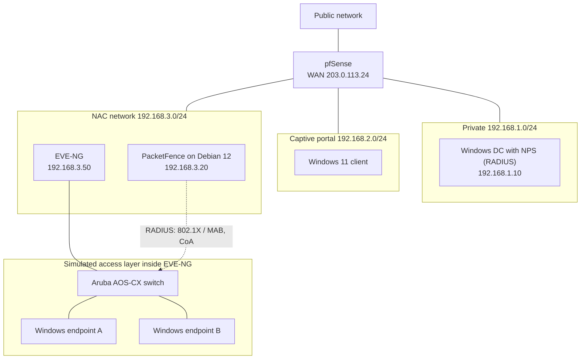

# Project 4: Network Access Control

**Focus:** identity-aware network access: captive portal, RADIUS with Active Directory, 802.1X with MAC authentication bypass, policy-based VLAN assignment
**Platforms:** pfSense captive portal, Windows Server (AD DS, NPS), PacketFence on Debian 12, Aruba AOS-CX virtual switch in EVE-NG, Windows 11

## Scenario

The fictional enterprise previously relied on perimeter firewall rules, with no user-based authentication at the network edge and no consistent policy for wired clients. This project adds two layers: (1) a captive portal backed by Active Directory, and (2) full network admission control for wired endpoints using PacketFence.

## Architecture

## Phase 1: captive portal with AD-backed RADIUS

1. **Network:** pfSense with four interfaces: public, private, captive-portal, and NAC (VM built UEFI with Secure Boot disabled, as in Project 1). Enable a DHCP server on the captive interface so clients receive a gateway and DNS.
2. **Directory:** Windows Server promoted to a domain controller in a new forest. Install **NPS**, register it in AD, add pfSense as a RADIUS client, and create a network policy for the allowed user group (see [NPS notes](../02-vpn/configs/nps-radius.md)).
3. **Authentication server:** pfSense → System → User Manager → Authentication Servers → add a RADIUS server pointing at the DC, with the shared secret and matching port and protocol.
4. **Captive portal:** Services → Captive Portal → add a zone, bind it to the captive interface (not any other), and choose the RADIUS server as the authentication backend.
5. **Test:** a client on the captive segment is blocked, redirected to the login page, and gets access only after valid domain credentials. Invalid credentials stay blocked.

## Phase 2: NAC with PacketFence

1. **PacketFence host:** Debian 12 VM (static address, FQDN), then install PacketFence from the vendor's repository per its installation guide and complete the web configurator (HTTPS on port 1443): management network, registration and isolation networks, and database/admin setup. Check the vendor's hardware sizing, since the lab VM was small.
2. **Access layer:** in EVE-NG, build a lab with an Aruba AOS-CX virtual switch and two Windows endpoints, and map the management cloud so the switch can reach PacketFence.
3. **Switch:** configure RADIUS toward PacketFence, port-access authentication (802.1X with MAC authentication bypass fallback), dynamic authorization (CoA), and VLANs. See [`configs/aos-cx-port-access-reference.cfg`](configs/aos-cx-port-access-reference.cfg).
4. **PacketFence:** add the switch (IP address, switch type, shared secret) and define the VLAN IDs for registration, isolation, and production. These must match the switch exactly.
5. **Endpoints:** enable the Windows *Wired AutoConfig* service, which is required for 802.1X on client Windows.
6. **Validate** the NAC workflow:

| Endpoint state | Expected network placement |
|----------------|----------------------------|
| Unknown / unregistered | Registration VLAN (restricted, redirected to registration) |
| Registered and authorized | Production VLAN (normal access) |
| Violating / non-compliant | Isolation VLAN |
| Rejected | No access |

## Results

- The captive portal enforced block-by-default, redirect, and authenticate-then-allow, with invalid credentials remaining blocked.
- PacketFence integrated with the switch over RADIUS, and the registration → production transition and the isolation/deny behavior worked as intended.
- Troubleshooting is in [troubleshooting.md](troubleshooting.md).

## Lessons learned

1. **Check dependencies first.** For RADIUS-backed captive portals, verify RADIUS reachability, the shared secret, the NPS client entry, and the policy before suspecting the portal. DNS and clock accuracy matter most for Kerberos and certificate-based methods, less for simple RADIUS password exchanges.
2. **Make both ends agree.** Switch, PacketFence, and NPS must agree on shared secrets, VLAN IDs, and enforcement mode, otherwise clients appear stuck in the wrong state.
3. **Validate the lab plumbing.** In EVE-NG, an incorrectly mapped cloud or wrong gateways look exactly like a NAC failure.
4. **Standardize and document** interfaces, addressing, and DNS before layering policy on top.
