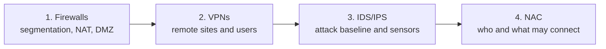

# IDS/Firewall and Access Control Configuration

> Team lab projects from a university network security course, rewritten as a sanitized portfolio. Please read the [DISCLAIMER](DISCLAIMER.md).

## Executive Summary

**Situation.** A fictional enterprise relied on perimeter firewalls alone. It needed segmented networks, secure remote connectivity for two remote sites and home workers, visibility into attacks, and identity-based control over who and what can join the network.

**Solution.** Over four stages, a virtualized enterprise network was designed and built on a Nutanix AHV lab, with each stage extending the last:

1. **Firewalls and segmentation:** two firewall platforms (pfSense and VyOS) separating public, private, and DMZ zones, with NAT, default-deny policy, and a separate Active Directory domain at each site.
2. **VPNs:** seven VPNs across IPsec/IKEv2, WireGuard, OpenVPN, and L2TP/IPsec, connecting remote sites and remote users, with Windows NPS (RADIUS) authenticating against Active Directory.
3. **Detection and prevention:** attacks from Kali Linux and Metasploit against intentionally vulnerable hosts, a Security Onion / Suricata sensor platform with a PCAP capture-and-import workflow, and passive and inline sensor topologies.
4. **Network access control:** a pfSense captive portal backed by Active Directory RADIUS, and PacketFence NAC with 802.1X and MAC authentication bypass on an Aruba AOS-CX switch.

**Results.**

| Area | Result |
|------|--------|
| Segmentation | Public, private, and DMZ zones on two firewall platforms. pfSense policy blocked and allowed the required traffic and could be monitored. VyOS enforced default-deny with NAT and traffic monitoring |
| Directory services | Two domain controllers, each in its own AD forest |
| VPN | Three site-to-site and four remote-access VPNs implemented and tested across four protocols |
| Authentication | RADIUS (NPS) integrated with VPN gateways and the captive portal, so users sign in with domain credentials |
| Security monitoring | Attack baseline established, sensor platform deployed, PCAP capture-and-import pipeline built, and inline sensor topology created |
| Access control | Captive portal blocked, redirected, and admitted users only after authentication. PacketFence placed endpoints into registration, production, or isolation states by policy |

**Skills demonstrated:** network design, firewall policy and NAT, VPN engineering, RADIUS/Active Directory integration, Suricata and Security Onion, 802.1X/NAC, virtualization, and documented troubleshooting.



## Projects

| # | Project | Technologies | Key outcome |
|---|---------|--------------|-------------|
| 1 | [Firewall Configuration and Management](01-firewall-configuration/) | pfSense, VyOS, NAT, DMZ, Active Directory | Two-site segmented network with default-deny policy |
| 2 | [Site-to-Site and Remote-Access VPNs](02-vpn/) | IPsec/IKEv2, WireGuard, OpenVPN, L2TP/IPsec, NPS | Seven VPNs with directory-backed authentication |
| 3 | [Network IDS/IPS](03-ids-ips/) | Suricata, Security Onion, Kali, Metasploit | Attack baseline, sensor platform, and PCAP analysis pipeline |
| 4 | [Network Access Control](04-network-access-control/) | pfSense captive portal, RADIUS, PacketFence, 802.1X/MAB, AOS-CX, EVE-NG | Identity-aware access with policy-based VLAN placement |

## Repository layout

```
.
├── DISCLAIMER.md
├── docs/            # timeline, addressing plan, skills matrix, references
├── 01-firewall-configuration/
├── 02-vpn/
├── 03-ids-ips/
└── 04-network-access-control/
```

## Conventions

- Public-side addresses use `203.0.113.0/24` (RFC 5737 documentation range). Private ranges use RFC 1918 space.
- Each project built a fresh environment, so addresses are scoped per project ([addressing plan](docs/addressing-plan.md)).
- Secrets appear as `<PLACEHOLDERS>`.
- **Reference configuration** marks a normalized configuration written for this portfolio. It has not been re-tested, so verify against current vendor docs.
- All attack activity was performed against intentionally vulnerable VMs in an isolated lab.
