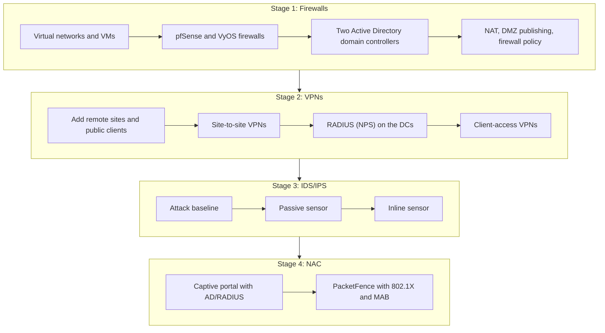

# Project Timeline and Dependencies

The four projects were completed in sequence over roughly one academic term, at about one project per month. Exact dates are omitted. Each builds on infrastructure or concepts from the one before it.

| Stage | Focus | Builds on | Key carry-over |
|-------|-------|-----------|----------------|
| 1 | Perimeter firewalls | New environment | Two firewall platforms, two DMZs, two AD domains |
| 2 | VPNs | Stage 1 sites | Firewalls become VPN gateways; DCs become RADIUS servers |
| 3 | Sensors | Stage 1 firewall and DMZ pattern | Same segmentation pattern used to place and test sensors |
| 4 | NAC | Stage 2 RADIUS/AD experience | NPS/RADIUS reused for captive-portal auth; RADIUS reused for 802.1X |

## Ordering within projects

Steps are presented in the order they depend on each other:

- **Project 2:** RADIUS (NPS) is configured *before* the client-access VPNs that authenticate against it. Site-to-site tunnels come first because one remote-access VPN reaches its RADIUS server across a site-to-site tunnel.
- **Project 3:** the attack baseline targets a host that already exists at that stage. The `vsftpd` scenario targets the DMZ host and therefore appears in Phase 2.
- **Project 4:** NPS/RADIUS setup precedes the captive portal that depends on it.
